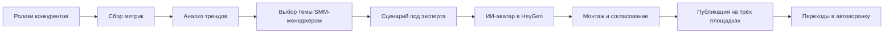

# Контент-система с ИИ-аватаром для школы кинологов

**Три специализированных агента помогают находить темы и готовить сценарии, HeyGen создаёт видео с аватаром, а SMM-менеджер и монтажёр ведут выпуск.**

[← Все кейсы](../README.md)

## Задача

Школе был нужен регулярный поток вертикальных видео для привлечения аудитории. Эксперт не мог постоянно участвовать в съёмках, а ручной поиск идей и подготовка сценариев мешали наладить выпуск.

Нужно было организовать производство от анализа работающих форматов до готового ролика и сохранить методологию эксперта.

## Мой вклад

Спроектировал систему из сборщика, трендвотчера и сценариста. Настроил сбор метрик роликов, анализ форматов и подготовку сценариев под нишу школы. Встроил ИИ-аватар HeyGen в процесс с согласованием и монтажом силами команды.

## Из чего состоит решение

| Компонент | Роль |
| --- | --- |
| Агент-сборщик | Ссылки, даты, описания и показатели роликов конкурентов |
| Агент-трендвотчер | Отбор тем и форматов, анализ хуков и вовлечения |
| Агент-сценарист | Адаптация идеи под методологию эксперта, сценарий и призыв к действию |
| HeyGen | Создание видео с ИИ-аватаром эксперта |
| SMM-менеджер | Выбор тем, запуск генерации, согласование и публикация |
| Монтажёр | Финальный монтаж, перебивки, субтитры и графика |

Конкретные поставщики парсинга, LLM и оркестратора в исходном описании не названы. HeyGen — подтверждённый сервис генерации аватара.

## Как работает

## Ключевые решения

- **Отдельные роли агентов.** Источники, критерии отбора и инструкции сценариста можно корректировать по отдельности.
- **Опора на материалы эксперта.** Сценарий адаптируется к нише и методологии школы.
- **Контроль выпуска у команды.** SMM-менеджер согласует темы и видео; монтажёр отвечает за смысловые перебивки и финальную картинку.
- **Несколько каналов распространения.** Готовые ролики использовались для YouTube Shorts, VK Клипов и Instagram.

## Проверка и внедрение

Сначала настраивались источники и критерии отбора, затем — стиль сценариев и проверка выдачи. Основные точки участия человека: выбор темы, монтаж и согласование перед публикацией.

## Результат

За первый месяц проекта в исходном описании зафиксированы:

- **10 млн просмотров** суммарно за 28 дней;
- **+25 000 подписчиков** на трёх площадках;
- **400 000 ₽ прямых продаж из автоворонки**.

Это результаты совместной работы системы, команды выпуска и воронки школы за указанный период. Они не являются изолированной оценкой вклада одного ИИ-инструмента. Съёмочная рутина эксперта была заменена процессом с аватаром и командой.

**Технологии:** сбор и анализ метрик контента, специализированные ИИ-агенты, сценарная база, HeyGen.

**Статус в описанном периоде:** внедрено в производство контента. Выход на новые языки рассматривался как возможность развития.

---

Опубликован разбор реализации. Код, рабочие автоматизации, промпты и материалы цифрового аватара закрыты.

[Обсудить похожую задачу](https://t.me/BorisKS) · [Все кейсы](../README.md)
