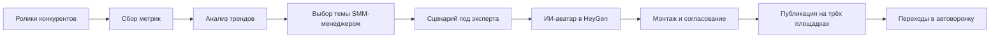

# Контент с ИИ-аватаром: +25 000 подписчиков и продажи из видео

**За первый месяц школа получила 10 млн просмотров, +25 000 подписчиков и 400 000 ₽ продаж из автоворонки. Для этого выстроили выпуск видео: AI-агенты находят темы и готовят сценарии, аватар снимает нагрузку с эксперта, а команда доводит контент до публикации.**

[← Все кейсы](../README.md)

## Задача бизнеса

Школа хотела привлекать аудиторию через короткие видео и дополнить платный трафик. Но выпуск зависел от времени эксперта: нужно было найти идею, написать сценарий, организовать съёмку и монтаж. Регулярное производство не складывалось.

Задача была в том, чтобы передать повседневный выпуск контент-команде и сохранить в роликах методологию и стиль эксперта.

## Как изменилась работа

| Рабочая задача | После внедрения |
| --- | --- |
| Регулярные съёмки требуют участия эксперта | Ролики с его цифровым аватаром готовит команда |
| Идеи и сценарии каждый раз нужно искать и писать | Сборщик, трендвотчер и сценарист готовят материалы для выбора |
| Просмотры сами по себе не ведут к продукту | В сценарии встроены призывы к действию и переход в воронку школы |

## Мой вклад

Спроектировал мультиагентную систему (multi-agent system), где сборщик, трендвотчер и сценарист отвечают за разные этапы производства контента. Настроил сбор метрик роликов, анализ форматов и подготовку сценариев под нишу школы. Встроил ИИ-аватар HeyGen в процесс с согласованием и монтажом силами команды.

## Из чего состоит решение

| Компонент | Роль |
| --- | --- |
| Агент-сборщик | Ссылки, даты, описания и показатели роликов конкурентов |
| Агент-трендвотчер | Отбор тем и форматов, анализ хуков и вовлечения |
| Агент-сценарист | Адаптация идеи под методологию эксперта, сценарий и призыв к действию |
| HeyGen | Создание видео с ИИ-аватаром эксперта |
| SMM-менеджер | Выбор тем, запуск генерации, согласование и публикация |
| Монтажёр | Финальный монтаж, перебивки, субтитры и графика |

Конкретные поставщики парсинга, LLM и оркестратора в исходном описании не названы. HeyGen — подтверждённый сервис генерации аватара.

## Как работает

## Ключевые решения

- **Отдельные роли агентов.** Источники, критерии отбора и инструкции сценариста можно корректировать по отдельности.
- **Настройка инструкций сценариста (prompt engineering).** Материалы эксперта, правила стиля и структура сценария помогают адаптировать идею к нише и методологии школы.
- **Human-in-the-loop перед публикацией.** SMM-менеджер выбирает темы и согласует видео, а монтажёр отвечает за смысловые перебивки и финальную картинку.
- **Несколько каналов распространения.** Готовые ролики использовались для YouTube Shorts, VK Клипов и Instagram.

## Проверка и внедрение

Сначала настраивались источники и критерии отбора, затем — стиль сценариев и проверка выдачи. Основные точки участия человека: выбор темы, монтаж и согласование перед публикацией.

## Результат

За первый месяц проекта в исходном описании зафиксированы:

- **10 млн просмотров** суммарно за 28 дней;
- **+25 000 подписчиков** на трёх площадках;
- **400 000 ₽ прямых продаж из автоворонки**.

Результат получен совместной работой AI-системы, команды выпуска и воронки школы за указанный период. SMM-менеджер выбирает и согласует материалы, монтажёр доводит ролики, а цифровой аватар позволяет выпускать видео без регулярных съёмок эксперта.

**Технологии:** сбор и анализ метрик контента, специализированные ИИ-агенты, сценарная база, HeyGen.

**Статус в описанном периоде:** внедрено в производство контента. Выход на новые языки рассматривался как возможность развития.

---

Опубликован разбор реализации. Код, рабочие автоматизации, промпты и материалы цифрового аватара закрыты.

[Обсудить выпуск контента с ИИ-аватаром](https://t.me/BorisKS) · [Все кейсы](../README.md)
