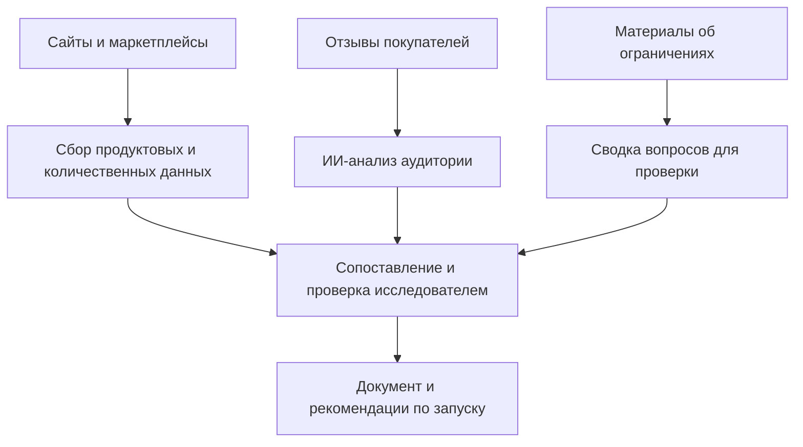

# Выход на рынок США: исследование и стратегия за 14 дней

**Оптовый поставщик получил основу для запуска собственного бренда в США: какие продукты рассматривать, кому их продавать и с какого канала начать. Исследование помогло выбрать старт через собственный сайт; сбор и анализ материалов заняли 14 дней.**

[← Все кейсы](../README.md)

## Задача бизнеса

Компания продавала сырьё оптом и рассматривала собственную торговую марку в США. Команде требовалось разобраться в незнакомом рынке до вложений в запуск: что предлагают конкуренты, какие форматы выбирают покупатели и где искать аудиторию.

Нужно было превратить разрозненные англоязычные данные в решения по продукту, позиционированию и каналам продаж. Отдельно — собрать вопросы по ограничениям, требующие проверки перед запуском.

## Как изменилась работа

| Рабочая задача | После внедрения |
| --- | --- |
| Продуктовую линейку нужно выбирать в незнакомом рынке | Сопоставлены продукты, форматы и предложения конкурентов |
| Мотивы покупателей скрыты в большом количестве отзывов | Материалы сгруппированы по задачам, барьерам и мотивам выбора |
| Варианты запуска ещё не сопоставлены | Подготовлены рекомендации; выбран старт через собственный сайт |

## Мой вклад

Организовал исследование с автоматическим сбором данных и ИИ-анализом материалов. Сопоставил сведения о конкурентах, спросе и аудитории, проверял выводы и подготовил рекомендации по позиционированию и запуску.

## Из чего состоит работа

| Блок | Содержание |
| --- | --- |
| Источники | Сайты конкурентов, маркетплейсы, отзывы, сервисы оценки трафика и продаж |
| Сбор данных | Продукты, форматы, источники посещений и оценочные показатели конкурентов |
| ИИ-анализ | Группировка отзывов, задачи покупателей, барьеры и мотивы выбора |
| Сопоставление | Сегменты аудитории, продуктовые гипотезы, позиционирование и каналы |
| Итоговый документ | Анализ рынка, конкурентов и продукта, PESTEL / SWOT, рекомендации |

Отдельным разделом в исследовании были собраны сведения о регулировании на дату работы. Эта страница описывает проект и не воспроизводит правовые выводы исследования.

## Как устроен процесс

## Ключевые решения

- **Разделение фактов и оценок.** Показатели выручки и продаж из сторонних аналитических сервисов рассматриваются как оценки, а не доступ к финансовой отчётности конкурента.
- **Отзывы как источник гипотез.** ИИ помогает группировать материалы и находить повторяющиеся задачи покупателей; выводы сопоставляются с остальными данными.
- **Экспертная сборка результата.** Автоматический сбор и генерация текста дополняются проверкой и выбором рекомендаций человеком.

Конкретные названия сервисов сбора и моделей в исходном кейсе не зафиксированы. Результат проекта — исследовательский документ; отдельный постоянно работающий программный продукт не заявляется.

## Результат

За **14 дней** подготовлены исследование и рекомендации для запуска. В описании проекта зафиксирован выбор старта через собственный DTC-сайт вместо первоначального выхода на Amazon.

Обсуждавшиеся расходы на продвижение не выдаются за фактически сэкономленные деньги. Данных о продажах после запуска в материалах этого кейса нет.

**Методы и инструменты:** автоматический сбор данных, ИИ-анализ текстов и отзывов, сторонние сервисы аналитики, JTBD, PESTEL и SWOT.

**Статус в описанном периоде:** исследование завершено; развитие контентных агентов рассматривалось как следующий этап.

---

Опубликовано описание исследовательского проекта. Клиентский отчёт, рабочие выгрузки, инструкции и внутренние материалы закрыты.

[Обсудить исследование перед запуском](https://t.me/BorisKS) · [Все кейсы](../README.md)
