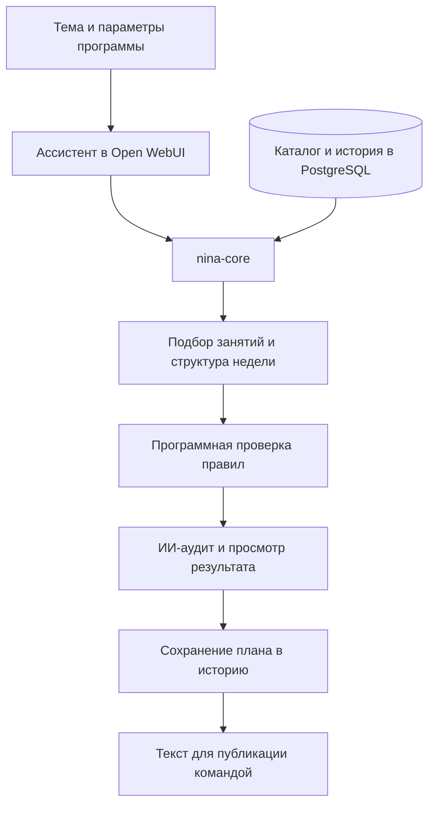

# ИИ-методолог: программы клуба по правилам эксперта

**Помог команде готовить недельные программы из реального каталога занятий с проверкой длительности, повторов и методологических ограничений. На контрольном этапе были подготовлены и сохранены 15 недель программ; итоговое утверждение остаётся за экспертом.**

[← Все кейсы](../README.md)

## Задача бизнеса

У программы клуба много связанных условий: тема недели, уровни участников, нагрузка по дням, длительность практик и история предыдущих программ. Важно не только подобрать подходящие занятия, но и сохранить логику авторской методики.

Команде был нужен помощник, который работает с реальными материалами клуба и проверяет формальные ограничения до передачи программы на согласование.

## Что получает команда

- **Материалы клуба в основе программы.** Ассистент использует каталог занятий с параметрами и историей, необходимыми для подбора.
- **Проверка до согласования.** Длительность, повторы и сочетания проходят программную проверку и ИИ-аудит.
- **Подготовка к публикации.** Команда получает структуру программы, описания и ссылки для дальнейшей работы.

## Мой вклад

Спроектировал и разработал отдельный сервис nina-core, структурировал каталог практик и связал его с ассистентом в Open WebUI. Реализовал подбор недельных планов, историю, программную проверку правил и форматирование выдачи.

Дорабатывал систему по материалам и обратной связи эксперта: уточнял классификацию практик, правила сочетания, последовательность мини-программ и формулировки описаний.

## Из чего состоит решение

| Компонент | Назначение |
| --- | --- |
| Open WebUI | Рабочий интерфейс методолога внутри корпоративного портала |
| LLM и инструкции ассистента | Большая языковая модель ведёт диалог, работает с темой и готовит текст |
| nina-core / FastAPI | Подбор практик, управление планами и предметные операции |
| PostgreSQL | Каталог занятий, классификация, история программ и результаты проверок |
| Программный валидатор | Проверка структуры, длительности, повторов и методологических ограничений |
| Серверный ИИ-аудит | Дополнительный разбор предложенного плана |
| Форматирование | Подготовка описаний, ссылок и структуры для публикации командой |

Инфраструктура портала раскрыта отдельно в [кейсе корпоративного AI-портала](corporate-ai-portal.md).

## Как работает

## Ключевые решения

**Вызов инструментов (tool calling).** Ассистент подключён к предметному сервису через OpenAPI tools: обращается к его методам для работы с каталогом и планами. Подбор использует реальные карточки с длительностью, категорией, уровнем и другими признаками.

**Проверка по формальным правилам (rule-based validation).** Код проверяет состав недели, повторы и размещение занятий. Инструкции модели дополняют этот слой и помогают сформировать связное описание программы.

**История влияет на следующую неделю.** Сохранённые планы используются при дальнейшем подборе. Для последовательных мини-программ учитывается порядок занятий.

**Оценка качества и контроль эксперта.** Проверка по правилам дополняется ИИ-аудитом и просмотром результата. Это human-in-the-loop: решение об утверждении программы остаётся за человеком.

## Проверка и доработка

Качество результатов оценивалось (AI evaluation) по соответствию каталогу и методологии, отсутствию повторов и точности описаний. Отдельно проверялись сохранение истории и последовательность мини-программ. Найденные противоречия разбирались по исходным карточкам и примерам методологии, после чего корректировалась конкретная логика подбора или формулировка.

## Результат

Создан рабочий инструмент подготовки программ внутри AI-портала. На контрольном этапе 19 октября 2026 года система работала с каталогом из **333 карточек**, были подготовлены и сохранены **15 недель тематических программ**.

Эти программы прошли серверные проверки, ИИ-аудит и отдельный просмотр. Финальное согласование экспертом — самостоятельный этап работы команды.

**Статус:** рабочая система, дорабатываемая по методологии и обратной связи.

**Стек:** Open WebUI, LLM, Python, FastAPI, PostgreSQL, OpenAPI tools, Docker Compose, Caddy.

---

Описание закрытого проекта. Код, каталог практик, методические инструкции и клиентские материалы не публикуются.

[Кейс корпоративного портала](corporate-ai-portal.md) · [Обсудить AI-инструмент по вашей методологии](https://t.me/BorisKS) · [Все кейсы](../README.md)
