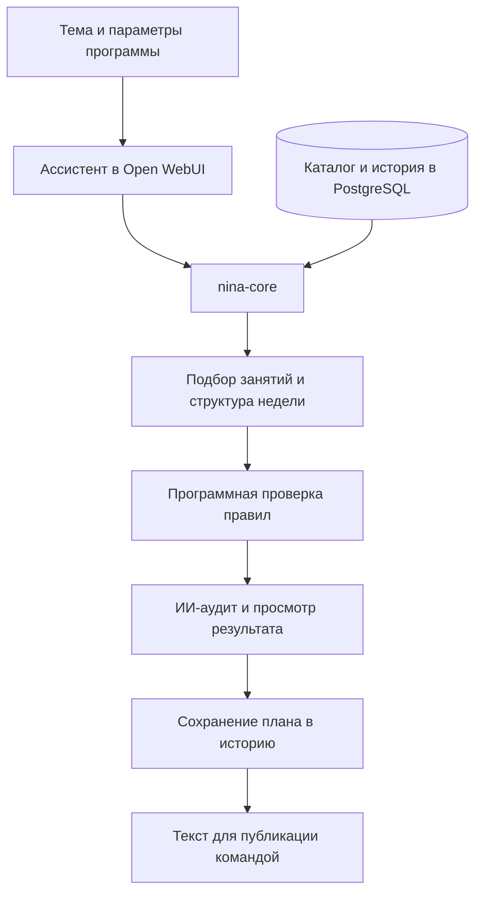

# ИИ-методолог для подготовки программ клуба

**Создал внутри AI-портала инструмент, который собирает недельные программы по методологии эксперта, использует внутренний каталог занятий и проверяет ограничения перед сохранением.**

[← Все кейсы](../README.md)

## Задача

Подготовка программы клуба требует учитывать тему, уровни участников, длительность практик, нагрузку по дням, сочетания занятий и историю предыдущих недель.

Нужно было перенести эту логику в систему, которая подбирает реальные материалы клуба и помогает контент-команде готовить программы для дальнейшей публикации.

## Мой вклад

Спроектировал и разработал отдельный сервис nina-core, структурировал каталог практик и связал его с ассистентом в Open WebUI. Реализовал подбор недельных планов, историю, программную проверку правил и форматирование выдачи.

Дорабатывал систему по материалам и обратной связи эксперта: уточнял классификацию практик, правила сочетания, последовательность мини-программ и формулировки описаний.

## Из чего состоит решение

| Компонент | Назначение |
| --- | --- |
| Open WebUI | Рабочий интерфейс методолога внутри корпоративного портала |
| LLM и инструкции ассистента | Диалог с пользователем, работа с темой и подготовка текста |
| nina-core / FastAPI | Подбор практик, управление планами и предметные операции |
| PostgreSQL | Каталог занятий, классификация, история программ и результаты проверок |
| Программный валидатор | Проверка структуры, длительности, повторов и методологических ограничений |
| Серверный ИИ-аудит | Дополнительный разбор предложенного плана |
| Форматирование | Подготовка описаний, ссылок и структуры для публикации командой |

Инфраструктура портала раскрыта отдельно в [кейсе корпоративного AI-портала](corporate-ai-portal.md).

## Как работает

## Ключевые решения

**Структурированный каталог.** Подбор опирается на реальные карточки с длительностью, категорией, уровнем и другими признаками. Система получает конкретные материалы клуба через отдельный сервис.

**Правила в программной логике.** Ограничения на состав недели, повторы и размещение занятий проверяются кодом. Инструкции модели дополняют этот слой и помогают сформировать связное описание программы.

**История влияет на следующую неделю.** Сохранённые планы используются при дальнейшем подборе. Для последовательных мини-программ учитывается порядок занятий.

**Несколько уровней проверки.** Формальная проверка дополняется ИИ-аудитом и просмотром результата. Прохождение автоматического аудита не подменяет согласование программы экспертом.

## Проверка и доработка

Проверялись выбор занятий из каталога, соответствие формальным правилам, сохранение истории, повторы, последовательность мини-программ и точность описаний. Найденные противоречия разбирались по исходным карточкам и примерам методологии, после чего корректировалась конкретная логика подбора или формулировка.

## Результат

Создан рабочий инструмент подготовки программ внутри AI-портала. На контрольном этапе 19 октября 2026 года система работала с каталогом из **333 карточек**, были подготовлены и сохранены **15 недель тематических программ**.

Эти программы прошли серверные проверки, ИИ-аудит и отдельный просмотр. Финальное согласование экспертом — самостоятельный этап работы команды.

**Статус:** рабочая система, дорабатываемая по методологии и обратной связи.

**Стек:** Open WebUI, LLM, Python, FastAPI, PostgreSQL, OpenAPI tools, Docker Compose, Caddy.

---

Описание закрытого проекта. Код, каталог практик, методические инструкции и клиентские материалы не публикуются.

[Кейс корпоративного портала](corporate-ai-portal.md) · [Обсудить похожую задачу](https://t.me/BorisKS) · [Все кейсы](../README.md)
