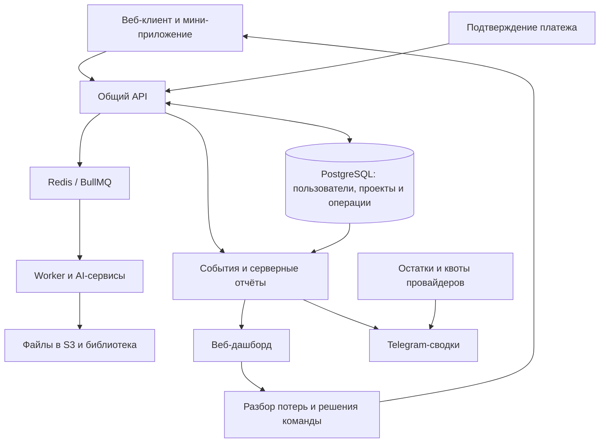

# Музыкальный AI-сервис: продукт, аналитика и рост конверсии

**Разработал сервис персональных песен, веб-дашборд и Telegram-аналитику. На основе данных команда доработала воронку; конверсия всех новых пользователей в оплату выросла с 3,5% до 12%.**

[← Все кейсы](../README.md)

## Задача

Создать музыкальный AI-продукт для массового пользователя: человек описывает идею или добавляет свой текст, получает бесплатное демо и может купить полную песню или пакет генераций.

После запуска требовалось понять, почему часть новых пользователей не доходила до покупки. Команде нужны были данные по всему пути: от входа и создания демо до прослушивания, предложения, счёта и подтверждённой оплаты.

Проект описан обезличенно, без названия, публичных адресов и клиентских материалов.

## Мой вклад

- Спроектировал и разработал веб-приложение и мини-приложение с общим сервером и пользовательскими данными.
- Реализовал создание песен, работу с текстом, плеер, библиотеку, внутренний кошелёк и оплату.
- Разработал веб-дашборд, сбор продуктовых событий и серверные отчёты.
- Связал пользовательские действия с генерациями, счетами и подтверждёнными платежами.
- Настроил Telegram-сводки, управление доступом и уведомления о состоянии внешних сервисов.
- Реализовывал технические изменения пользовательского пути по результатам совместного разбора воронки.

Разработку и доработки вёл с помощью Codex. Анализ рекламных креативов, тексты оферов и сценарии коммуникаций готовились совместно с маркетинговой командой.

## 1. Музыкальный продукт

Пользователь может создать бесплатное демо, подготовить текст по идее или добавить собственный, выбрать жанр и вокал, а затем получить готовые варианты песни. Для соответствующего сценария предусмотрен профиль собственного голоса.

Сервис включает библиотеку, воспроизведение и скачивание доступных MP3, пакеты генераций и внутренний баланс. В браузере реализован гостевой вход: первое демо можно создать без предварительного ввода почты и кода подтверждения.

Создание музыки выполняется в фоне. Сервер хранит состояние задания, а результат сохраняется в библиотеке. Доступ к платным возможностям связан с подтверждённой оплатой и состоянием кошелька.

## 2. Веб-дашборд и продуктовая аналитика

Внутренняя панель позволяет разбирать движение пользователей по этапам и сравнивать результаты изменений.

| Блок | Что показывает |
| --- | --- |
| Воронка | Вход в сценарий, создание, готовность и прослушивание демо, предложение, счёт и оплата |
| Периоды и когорты | Календарные срезы, сравнение групп новых пользователей и личные окна наблюдения |
| Источники | UTM, кампании, рассылки и отдельные публикации |
| Предложения и тарифы | Показы, действия с кнопками, выбор пакетов, создание счетов и покупки |
| Первая покупка | Время от первого аккаунта или готового демо до подтверждённой оплаты |
| Операционная часть | Генерации, ошибки, выручка и расходы на AI |

Уникальные покупатели отделены от количества платёжных операций. Для процентов показывается основание расчёта; календарные отношения и конверсия одной когорты рассматриваются отдельно. Тестовые аккаунты команды и дубли объединённых пользователей исключаются по правилам отчётов.

Яндекс.Метрика и Webvisor используются как дополнительные инструменты исследования поведения.

## 3. Что изменили на основе аналитики

Разбор показал потери на ранних шагах: часть людей не начинала создание песни, не возвращалась к готовому демо или слишком поздно видела предложение. При этом платёжный этап не выглядел главным ограничением среди пользователей, уже дошедших до него.

| Наблюдение | Направление работы и реализованные изменения |
| --- | --- |
| Препятствия до первого результата | Реализован гостевой сценарий браузера без предварительной почты и OTP |
| Предложение появлялось поздно | Доработан экран готовой песни: плеер, понятный офер и заметное действие покупки рядом с результатом |
| Интерес к скачиванию не был явным путём к продаже | Скачивание неоплаченного демо связано с предложением покупки; доступ к файлам открывается после подтверждения оплаты |
| Самостоятельная работа с текстами требовала усилий | Реализованы структурированные вопросы и варианты в конструкторе песни, добавлена аналитика заполнения |

Параллельно команда проработала уведомления, возврат к готовой песне и новые поводы для повторной покупки. Это отдельные направления развития; весь план дальнейших задач не приравнивается к уже внедрённым изменениям.

## 4. Telegram-сводки и оперативный контроль

Бот использует тот же серверный сервис показателей, что веб-дашборд. В Telegram доступны регистрации, этапы демо, покупатели, оплаты, выручка, генерации и ошибки.

Можно выбрать сегодня, вчера или неделю, переключить платформу, обновить карточку и перейти к защищённой веб-панели. Ежедневная сводка приходит в выбранное время. Доступ коллегам выдаётся по одобрению владельца и может быть отозван.

Отдельно отображаются текущие остатки провайдеров, расходы на AI и квота почтового сервиса. При остатке писем ниже 20% включается напоминание с ограничением частоты. Недоступные значения показываются явно.

## Архитектура

| Слой | Технологии |
| --- | --- |
| Клиент и графики | TypeScript, React, Vite, Recharts |
| Сервер и данные | NestJS, Fastify, PostgreSQL, Prisma |
| Фоновая обработка | Redis, BullMQ, worker |
| Медиа | Приватное S3-хранилище, генеративные API |
| Интеграции | AI-генерация, платёжные webhooks, мессенджеры и почта |
| Оперативная аналитика | Telegram Bot API и API внешних сервисов |
| Развёртывание | Docker Compose, Caddy, Nginx |

## Проверка

При разработке проверялись авторизация, создание и восстановление пользовательских проектов, состояния генераций и платёжные уведомления. Для аналитики проверялись основания процентов, уникальные покупатели, временные окна, фильтры и согласованность с серверными данными.

Для Telegram проверялись права доступа, форматирование карточек, расписание, состояние после перезапуска и совпадение показателей с веб-панелью. В проекте используются API- и интерфейсные тесты, проверка типов и production-сборки.

## Результат

По данным проекта, **конверсия всех новых пользователей в оплату выросла с 3,5% до 12%**. Показатель — доля новых пользователей, совершивших оплату. Рост составил **8,5 процентного пункта**, или примерно **в 3,4 раза** относительно исходной доли.

Результат относится к совокупной работе над продуктом и воронкой на основе аналитики. Дашборд помог обнаружить потери и выбрать приоритеты, доработки изменили пользовательский путь, а Telegram обеспечил оперативный доступ к показателям.

В итоге команда получила работающий продукт, инструмент разбора воронки и регулярный контроль ключевых цифр в одной системе.

**Статус:** продукт и аналитика внедрены, развитие продолжается итерациями.

---

Описание закрытого проекта. Исходный код, рабочие конфигурации, пользовательские данные и внутренние адреса не публикуются.

[Обсудить похожую задачу](https://t.me/BorisKS) · [Все кейсы](../README.md)
