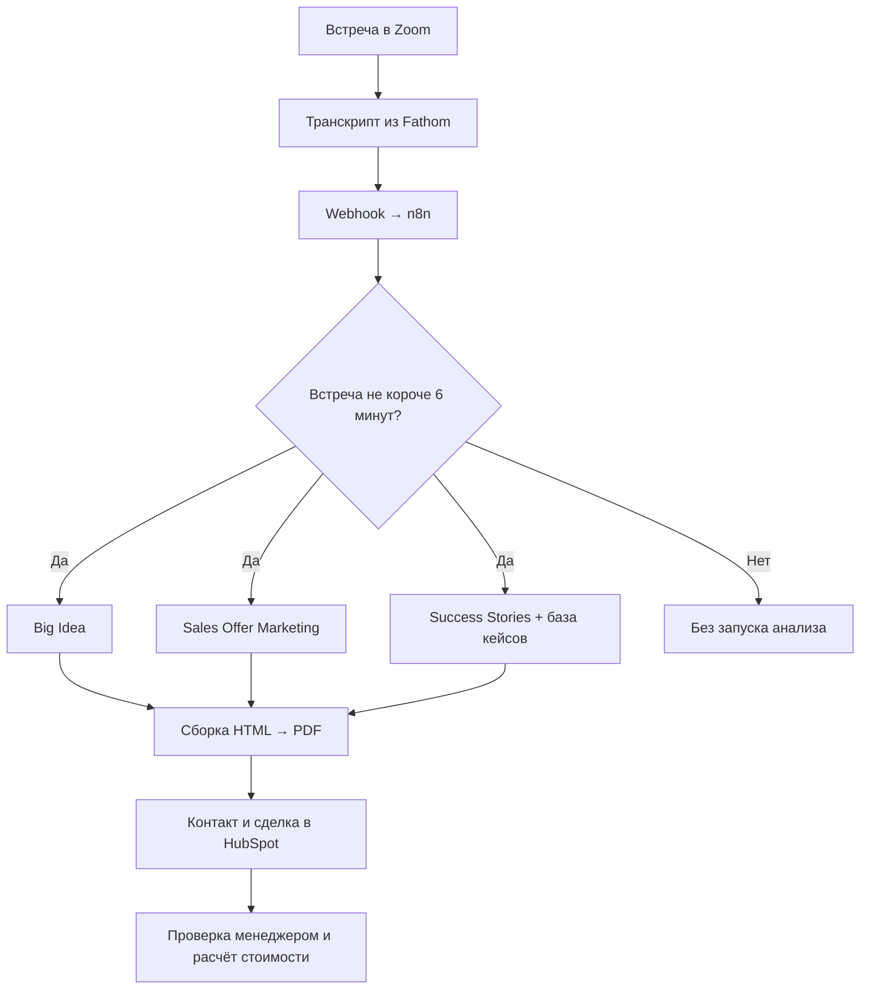

# ИИ-подготовка коммерческих предложений для digital-агентства

**Три специализированных агента превращают расшифровку встречи в структуру персонального предложения и доставляют отчёт в CRM.**

[← Все кейсы](../README.md)

## Задача

В международном digital-агентстве менеджеры вручную разбирали встречи, выделяли задачи клиента и искали подходящие кейсы. Подготовка структуры одного КП занимала 30–40 минут. При росте потока заявок этот этап задерживал дальнейшую работу с клиентами.

Нужно было сократить подготовительную работу и сохранить привязку предложения к конкретному бизнесу.

## Мой вклад

Спроектировал мультиагентную систему (multi-agent system): три специализированных AI-агента выполняют разные части подготовки предложения. Подготовил базу из 70 кейсов агентства, настроил инструкции и проверил выдачу с отделом продаж. После тестирования через Telegram перенёс процесс в n8n и связал получение транскриптов, генерацию PDF и доставку в HubSpot.

## Из чего состоит решение

| Компонент | Роль |
| --- | --- |
| Zoom / Fathom | Встреча, запись, расшифровка и передача данных |
| Webhook и n8n | Запуск процесса, проверка длительности встречи и координация обработки |
| Агент Big Idea | Цели клиента, проблемы, продукт, аудитория и мотивы покупки |
| Агент Sales Offer Marketing | Связь запроса с услугами, структура предложения и предлагаемые KPI |
| Агент Success Stories | Подбор примеров из подготовленной базы кейсов |
| Генератор PDF | Сборка ответов в HTML и формирование отчёта A4 |
| HubSpot CRM API | Поиск контакта по email и прикрепление отчёта к контакту и сделке |

## Как работает

Это схема функциональных блоков; внутренняя конфигурация автоматизации не публикуется.

## Ключевые решения

- **Оркестрация в n8n.** Управление workflow — последовательностью обработки — связывает получение транскрипта, три потока анализа, сборку PDF и доставку в CRM.
- **Подготовленная база знаний.** Агент подбирает примеры из материалов компании, а не сочиняет клиентские кейсы.
- **API-интеграция с CRM.** Готовый отчёт передаётся в HubSpot программно. Менеджеру не нужно вручную переносить транскрипт и искать результат в другом сервисе.
- **Human-in-the-loop.** Человек остаётся на этапе принятия решения: проверяет предложение, определяет расценки, скидки и загрузку команды.

## Проверка и внедрение

Внедрение заняло 5 недель. Сначала менеджеры проверяли результат на загруженных вручную транскриптах. По обратной связи уточнялись инструкции, сокращались лишние пункты и исправлялись неподтверждённые выводы. Затем был настроен автоматический процесс после встречи.

## Результат

Подготовка структуры КП сократилась **с 40 до 5 минут**. По описанию внедрения экономия времени менеджера составляла **до 4 часов в день**.

Эти показатели относятся к анализу встречи и сборке основы предложения. Проверка, согласование и финальный расчёт стоимости остаются отдельной работой менеджера.

**Стек на момент внедрения:** n8n, OpenAI Assistants API / LangChain OpenAI, Zoom, Fathom, webhooks, PDF Generator API, HubSpot CRM API.

**Статус в описанном периоде:** внедрено в рабочий процесс. Генерация задач в ClickUp и медиаплана рассматривалась как следующий этап и не включена в результаты этого кейса.

---

Опубликован разбор реализации. Код, workflow, промпты и клиентская база знаний закрыты.

[Обсудить похожую задачу](https://t.me/BorisKS) · [Все кейсы](../README.md)
