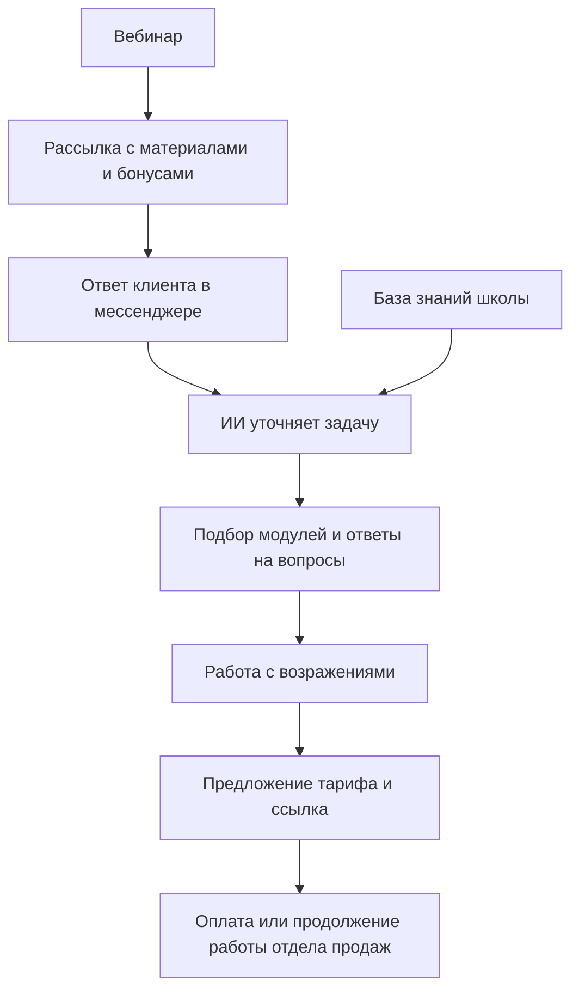

# ИИ-продавец для онлайн-школы кинологов

**Ассистент ведёт диалог после вебинара: выясняет задачу клиента, отвечает по базе знаний и предлагает подходящий курс и тариф.**

[← Все кейсы](../README.md)

## Задача

После мастер-классов школа отправляла сообщения потенциальным клиентам, но продажи через бот отсутствовали. В базе накопилось около 7 000 контактов, а менеджеры не успевали обрабатывать весь поток.

Нужно было встроить содержательный диалог в существующую воронку: помочь человеку разобраться в своей ситуации и предложить релевантный продукт.

## Мой вклад

Разработал логику диалога и инструкции для ассистента. На основе более 100 успешных звонков отдела продаж подготовил материалы по вопросам клиентов, возражениям и формулировкам. Настроил использование базы знаний и дорабатывал ответы на реальных диалогах.

## Из чего состоит решение

| Компонент | Роль |
| --- | --- |
| Существующая рассылка и мессенджер | Возвращают человека к диалогу после вебинара |
| ИИ-ассистент | Уточняет породу и возраст собаки, ситуацию и задачу владельца |
| Векторная база знаний | Информация о курсах, модулях, тарифах, вопросах и возражениях |
| Сценарий продажи | Переход от задачи клиента к подходящей программе и предложению |
| Ссылка на тариф и отдел продаж | Следующий шаг для заинтересованного клиента |

Названия модели, векторного хранилища и платформы оркестрации в исходном описании не зафиксированы; конкретных поставщиков этому кейсу не приписываю.

## Как работает

## Ключевые решения

- **Знания из реальных продаж.** В базу включены вопросы и возражения из успешных звонков.
- **Уточнение задачи до предложения.** Ассистент учитывает ситуацию владельца собаки и связывает её с модулями курса.
- **Ограничение тематики.** По медицинским вопросам предусмотрено направление к ветеринару; ассистент работает в рамках продукта школы.
- **Итерационная настройка стиля.** Корректировались длина сообщений, обращения к людям с никнеймами и лишняя разметка.

## Проверка и внедрение

Работа заняла около 2 месяцев: первичная логика и знания о продукте, разбор звонков, затем тестирование на лидах и доработка диалогов. Отдельным направлением стала реактивация накопленной базы.

## Результат

По данным кейса, конверсия в оплату через канал бота после вебинара выросла **с 0% до 10–15% за 2 месяца**.

Показатель относится к этому каналу продаж. Размер выборки и точное основание расчёта процента в опубликованных материалах не раскрыты; его нельзя переносить на все 7 000 контактов или всю воронку школы.

**Технологии:** LLM, векторная база знаний, сценарии диалога, интеграция с рассылкой и мессенджером.

**Статус в описанном периоде:** внедрено, проводилась работа с новыми лидами и реактивацией базы.

---

Опубликован разбор реализации. Код, настройки бота, промпты, записи звонков и переписки клиентов закрыты.

[Обсудить похожую задачу](https://t.me/BorisKS) · [Все кейсы](../README.md)
