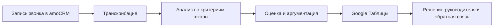

# Контроль продаж с ИИ: 2 часа в неделю вместо 16

**Руководитель получает разбор звонков и ошибки менеджеров в готовой таблице. Работа с записями сместилась к разбору выводов и обратной связи команде: время на контроль сократилось в 8 раз.**

[← Все кейсы](../README.md)

## Задача бизнеса

В онлайн-школе руководитель тратил много времени на поиск и прослушивание звонков, но проверить удавалось только часть разговоров. Обратная связь приходила с задержкой: менеджер уже продолжал работать, а ошибки в предыдущих диалогах ещё не были разобраны.

Нужно было дать руководителю быстрый доступ к сути разговора и основаниям оценки, чтобы он мог выбирать, какие ситуации разобрать с командой.

## Как изменилась работа

| Рабочая задача | После внедрения |
| --- | --- |
| Чтобы понять диалог, нужно найти и прослушать запись | Доступны текст разговора, разбор и аргументы оценки |
| Проверка ограничивается доступным временем руководителя | Первичную обработку выполняет система по заданным критериям |
| Руководитель тратит 16 часов в неделю на контроль | Около 2 часов уходит на работу с выводами и управленческие решения |

## Мой вклад

Подключил источник звонков, настроил транскрибацию и ИИ-анализ под критерии школы. Организовал выгрузку результатов в таблицу и обучил команду использовать разборы в работе.

## Из чего состоит решение

| Компонент | Роль |
| --- | --- |
| amoCRM | Источник записей входящих и исходящих звонков |
| Speech-to-Text (STT) | Распознавание речи: перевод аудиозаписи в текст для дальнейшего анализа |
| LLM-аналитик | Языковая модель разбирает ошибки, работу с возражениями и признаки готовности к покупке |
| Google Таблицы | Сводный просмотр оценок, аргументации и резюме |
| Руководитель и менеджеры | Разбор проблемных ситуаций и корректировка работы |

Провайдер транскрибации, модель и связующий инструмент в исходном кейсе не названы.

## Как работает

## Ключевые решения

- **Автоматическая оценка звонков (call scoring).** Диалоги оцениваются по критериям конкретного отдела: как менеджер выясняет задачу, презентует продукт и работает с возражениями.
- **Текст и аргументация рядом с оценкой.** Руководитель может разобраться в выводе и выбрать разговор для дополнительной проверки.
- **Общий рабочий интерфейс.** Сводка доступна руководителю и менеджерам в привычной таблице.

Оценка вероятности продажи — вывод модели по разговору. В кейсе нет данных о её статистической калибровке, поэтому она используется как ориентир для разбора.

## Проверка и внедрение

Запуск занял 2 недели: интеграция звонков и настройка критериев, затем отладка выгрузки и обучение команды. В описанном внедрении охват вырос с менее 20% до всех звонков подключённого потока.

## Результат

Затраты времени руководителя на контроль снизились **с 16 до 2 часов в неделю — в 8 раз**. Два часа относятся к управленческим решениям по готовой сводке. Указанные в исходном кейсе 20 минут машинной обработки — отдельный показатель, который не подменяет время человека.

**Стек:** amoCRM, сервис транскрибации, LLM, Google Таблицы.

**Статус в описанном периоде:** внедрено. Отдельная система критериев для лидогенераторов планировалась как развитие.

---

Опубликован разбор реализации. Код, записи разговоров, транскрипты и внутренние оценки сотрудников закрыты.

[Обсудить контроль качества продаж](https://t.me/BorisKS) · [Все кейсы](../README.md)
