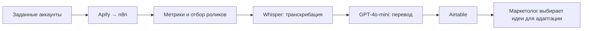

# Идеи для Reels без 50 часов ручного поиска в месяц

**Маркетолог агентства недвижимости получает подборку зарубежных роликов с метриками и переводом на русский. Автоматизированы сбор и первичный разбор, на которые прежде уходило до 50 часов в месяц; команда выбирает идеи и адаптирует их под свой рынок.**

[← Все кейсы](../README.md)

## Задача бизнеса

Агентство недвижимости в Италии искало идеи у риэлторов на зарубежных рынках. Работа превращалась в долгий просмотр профилей: найти сильный ролик, оценить его показатели и понять содержание на другом языке.

Большое число просмотров ещё нужно было соотнести с размером аудитории автора. Требовалась подборка, где рядом с видео есть данные для отбора и понятный текст, а маркетолог может сосредоточиться на адаптации.

## Как изменилась работа

| Рабочая задача | После внедрения |
| --- | --- |
| Конкурентов нужно регулярно просматривать вручную | Система собирает ролики и метрики заданных аккаунтов |
| Количество просмотров трудно оценить без контекста | Ролики сравниваются с учётом числа подписчиков автора |
| Содержание иностранных видео нужно разбирать отдельно | У отобранных роликов сохранены транскрипт и русский перевод |

## Мой вклад

Собрал data pipeline — автоматический поток данных от сбора до выдачи команде: Apify получает ролики и метрики, n8n управляет обработкой, Airtable хранит подборку. Подключил Whisper для транскрибации и GPT-4o-mini для перевода отобранных роликов.

## Из чего состоит решение

| Компонент | Роль |
| --- | --- |
| Apify | Сбор роликов и показателей заданных аккаунтов |
| n8n | Регулярный запуск, обработка, фильтрация и передача данных |
| Правило отбора | Отношение просмотров ролика к числу подписчиков автора |
| OpenAI Whisper / Speech-to-Text | Распознавание речи в иностранных роликах и получение текста |
| GPT-4o-mini | Языковая модель (LLM) переводит полученный текст на русский |
| Airtable | База роликов, метрик, транскриптов и переводов для маркетолога |

## Как работает

## Ключевые решения

- **Регулярный мониторинг.** В описанной конфигурации сбор запускался каждые 3 дня.
- **Относительный показатель.** Отбирались ролики с отношением просмотров к подписчикам выше 50%. Это правило приоритизации, которое помогает учитывать размер аккаунта; оно не гарантирует успех повторного формата.
- **Перевод после отбора.** Транскрибация и перевод применяются к выбранным роликам.
- **Ссылка и содержание в одной базе.** Команда может открыть оригинал, проверить идею и адаптировать её под свой рынок.

## Проверка и внедрение

Запуск занял 1 неделю: сначала сбор метрик и база Airtable, затем транскрибация и настройка перевода.

## Результат

Автоматизирован сбор и первичный разбор контента, который ранее занимал **до 50 часов ручной работы в месяц**. В исходном кейсе указано около **10 минут машинного времени обработки**; это длительность обработки, а не сопоставимый месячный бюджет работы маркетолога.

Выбор идей, адаптация и съёмка остаются задачами команды.

**Стек на момент внедрения:** Apify, n8n, Airtable, OpenAI Whisper, GPT-4o-mini.

**Статус в описанном периоде:** мониторинг, транскрибация и перевод внедрены. Автоматический сценарист и ИИ-аватары рассматривались как будущие этапы.

---

Опубликован разбор реализации. Код, workflow, перечень отслеживаемых аккаунтов и клиентская база материалов закрыты.

[Обсудить мониторинг контента в вашей нише](https://t.me/BorisKS) · [Все кейсы](../README.md)
