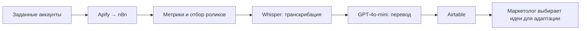

# ИИ-трендвотчер для агентства недвижимости

**Система собирает ролики зарубежных конкурентов, отбирает форматы по метрикам, расшифровывает речь и переводит её на русский.**

[← Все кейсы](../README.md)

## Задача

Агентство недвижимости в Италии искало идеи для Reels на зарубежных рынках. Мониторинг, оценка роликов и перевод занимали у маркетолога до 50 часов в месяц.

Нужно было организовать регулярный сбор и дать команде подборку с исходными ссылками, метриками и понятным содержанием.

## Мой вклад

Настроил сбор профилей через Apify, координацию процесса в n8n и выдачу в Airtable. Подключил Whisper для транскрибации и GPT-4o-mini для перевода отобранных роликов.

## Из чего состоит решение

| Компонент | Роль |
| --- | --- |
| Apify | Сбор роликов и показателей заданных аккаунтов |
| n8n | Регулярный запуск, обработка, фильтрация и передача данных |
| Правило отбора | Отношение просмотров ролика к числу подписчиков автора |
| OpenAI Whisper | Распознавание речи в иностранных роликах |
| GPT-4o-mini | Перевод текста на русский |
| Airtable | База роликов, метрик, транскриптов и переводов для маркетолога |

## Как работает

## Ключевые решения

- **Регулярный мониторинг.** В описанной конфигурации сбор запускался каждые 3 дня.
- **Относительный показатель.** Отбирались ролики с отношением просмотров к подписчикам выше 50%. Это правило приоритизации, которое помогает учитывать размер аккаунта; оно не гарантирует успех повторного формата.
- **Перевод после отбора.** Транскрибация и перевод применяются к выбранным роликам.
- **Ссылка и содержание в одной базе.** Команда может открыть оригинал, проверить идею и адаптировать её под свой рынок.

## Проверка и внедрение

Запуск занял 1 неделю: сначала сбор метрик и база Airtable, затем транскрибация и настройка перевода.

## Результат

Автоматизирован сбор и первичный разбор контента, который ранее занимал **до 50 часов ручной работы в месяц**. В исходном кейсе указано около **10 минут машинного времени обработки**; это длительность обработки, а не сопоставимый месячный бюджет работы маркетолога.

Выбор идей, адаптация и съёмка остаются задачами команды.

**Стек на момент внедрения:** Apify, n8n, Airtable, OpenAI Whisper, GPT-4o-mini.

**Статус в описанном периоде:** мониторинг, транскрибация и перевод внедрены. Автоматический сценарист и ИИ-аватары рассматривались как будущие этапы.

---

Опубликован разбор реализации. Код, workflow, перечень отслеживаемых аккаунтов и клиентская база материалов закрыты.

[Обсудить похожую задачу](https://t.me/BorisKS) · [Все кейсы](../README.md)
