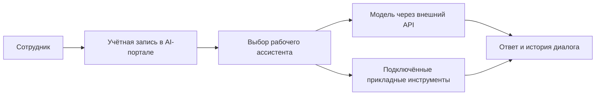

# Корпоративный AI-портал для команды

**Развернул общую рабочую среду с доступом к языковым моделям, личным учётным записям и специализированным AI-ассистентам.**

[← Все кейсы](../README.md)

## Задача

Организовать использование ИИ внутри команды: дать сотрудникам единый интерфейс, разграничить доступ и подготовить ассистентов под рабочие задачи.

Портал должен был стать общей средой для повседневной работы и основой для подключения более сложных внутренних инструментов.

## Мой вклад

Развернул Open WebUI на VPS Beget, подключил языковую модель через внешний API, настроил учётные записи, рабочие пространства и доступы. Подготовил специализированных ассистентов под задачи команды.

На этой же платформе было создано отдельное прикладное решение — [ИИ-методолог](ai-methodologist-nina.md). В этом кейсе рассматривается общая среда и организация работы сотрудников; логика подготовки программ занятий раскрыта в кейсе методолога.

## Из чего состоит решение

| Слой | Что даёт команде |
| --- | --- |
| Open WebUI | Браузерный интерфейс чатов и работы с ассистентами |
| Учётные записи и права | Отдельный доступ сотрудников и управление со стороны администратора |
| История диалогов | Возможность продолжать работу в контексте прежних обсуждений |
| Настроенные ассистенты | Инструкции и рабочий контекст под конкретные задачи |
| Внешний LLM API | Подключение большой языковой модели к общей среде через программный интерфейс |
| VPS и HTTPS | Серверное развёртывание и защищённое подключение к порталу |

## Как работает

## Ключевые решения

**Знакомый интерфейс для разных задач.** Сотрудник работает через браузер и выбирает нужного ассистента, а настройки модели и подключений остаются в административном слое.

**Ролевой доступ (RBAC).** Сотрудники пользуются рабочими инструментами через свои учётные записи, а администратор управляет доступом и настройками портала.

**Специализация через инструкции.** Под разные роли можно настроить отдельный контекст и формат результата. Это уменьшает объём вводных, которые сотруднику нужно повторять при каждом обращении.

**Основа для предметной автоматизации.** Если задаче требуются структурированные данные и проверяемые правила, к порталу подключается отдельный сервис. Такой подход применён в ИИ-методологе.

## Проверка и внедрение

При настройке проверялись доступность модели из серверной среды, работа пользовательских учётных записей, сохранение истории и доступ к выбранным ассистентам. Портал используется как внутренняя рабочая среда команды.

## Результат

Команда получила общий AI-портал с управляемым доступом и подготовленными ассистентами. Появилась инфраструктурная основа, на которой можно развивать внутренние AI-инструменты без создания отдельного интерфейса для каждого из них.

**Статус:** внедрён для работы команды.

**Стек:** Open WebUI, GPT / внешний LLM API, VPS Beget, Docker, Caddy / HTTPS.

---

Описание закрытого внедрения. Рабочие настройки, системные инструкции, адрес портала и диалоги сотрудников не публикуются.

[Кейс ИИ-методолога](ai-methodologist-nina.md) · [Обсудить похожую задачу](https://t.me/BorisKS) · [Все кейсы](../README.md)
