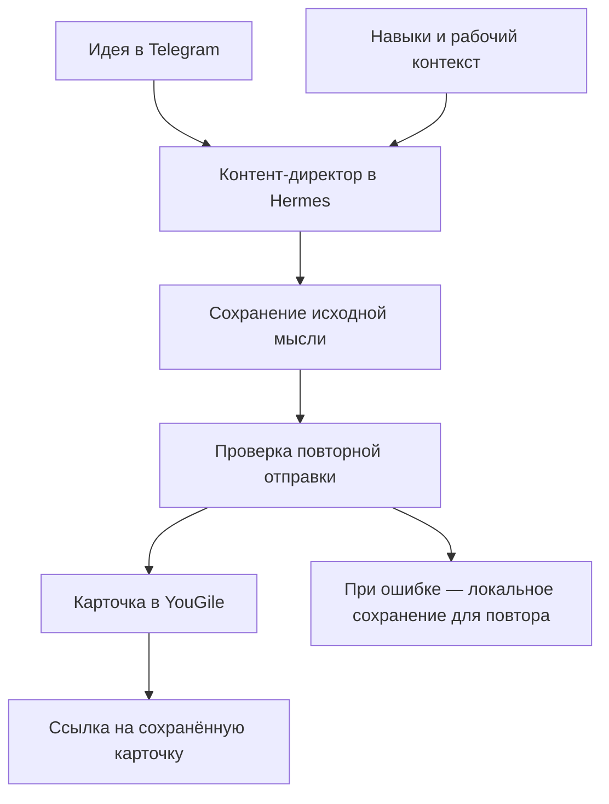

# AI-помощник Hermes: от идеи в переписке к рабочей задаче

**Связал персонального AI-помощника с Telegram и YouGile. Идея из общения получает карточку в рабочей системе, а память и навыки помогают продолжать работу с сохранённым контекстом.**

[← Все кейсы](../README.md)

## Задача бизнеса

В работе с контентом мало получить хороший ответ от ИИ: идею нужно сохранить, найти позже и довести до выпуска. Помощнику также требовался постоянный контекст, чтобы не начинать каждое обращение с повторного объяснения задачи.

Нужна была связка между перепиской и системой задач: исходная мысль, описание, подтверждённое сохранение и ссылка на карточку.

## Что получает команда

- **Идея переходит в работу.** Помощник сохраняет её в YouGile и возвращает ссылку на созданную карточку.
- **Контекст доступен между обращениями.** Память, история и настроенные навыки поддерживают повторяющиеся задачи.
- **Повторная отправка учитывается.** Проверка дублей возвращает существующую карточку, а при ошибке сохраняется исходный текст для повтора.

## Мой вклад

Развернул Hermes на Linux VPS, настроил подключение модели, gateway и собственные навыки. Подготовил персональный рабочий контекст и отдельный профиль контент-директора.

Подключил Telegram и интеграцию с YouGile для сохранения идей. Организовал разделение версионируемых настроек и приватного состояния, предусмотрел перенос среды на другой сервер.

## Из чего состоит решение

| Компонент | Назначение |
| --- | --- |
| Hermes Agent | Среда исполнения помощника, навыков и инструментов |
| GPT и конфигурация провайдера | Языковая модель для диалога и выполнения задач |
| Долговременная память (persistent memory) и история | Сохранение рабочего контекста между обращениями |
| Пользовательские навыки | Повторяемые способы решения задач и подготовки контента |
| Telegram gateway | Взаимодействие с помощником из мессенджера |
| Профиль Content Director | Отдельный контекст работы с идеями и контентом |
| Python-клиент YouGile API | Создание и поиск карточек идей |
| systemd | Запуск и управление gateway на VPS |

## Пример рабочего сценария

## Ключевые решения

**Настройка рабочего контекста (context engineering).** Для контент-директора подготовлены отдельные инструкции и навыки: какие идеи сохранять, как развивать материал и куда передавать результат.

**Сохранение результата в рабочую систему.** Идея получает карточку в YouGile; её можно развивать и перемещать по процессу подготовки контента.

**Дедупликация — защита от дублей.** Повторное сохранение одной и той же идеи возвращает существующую карточку. Поиск учитывает и карточки, которые уже переместили в другую колонку доски.

**Подтверждённая запись.** Ссылка возвращается после успешного сохранения. При ошибке исходный текст остаётся локально для повторной отправки.

**Переносимость среды.** Навыки и шаблоны конфигурации версионируются отдельно от приватной памяти, переписок и учётных данных. Для приватного состояния предусмотрено зашифрованное резервирование.

## Проверка

Проверялись создание карточки через профиль агента, сохранность исходного текста, повторная отправка без новой карточки и состояние Telegram gateway. При переносе существующего банка идей сопоставлялись исходные записи и созданные задачи.

## Результат

Создан персональный помощник с постоянным рабочим контекстом и отдельным контентным профилем. Подтверждён сценарий от идеи в среде агента до сохранённой карточки YouGile с обратной ссылкой.

Помощник и контентный процесс доступны через Telegram; навыки и конфигурацию можно переносить между серверами с отдельным восстановлением приватного состояния.

**Статус:** серверная среда и интеграция с YouGile настроены и проверены.

**Стек:** Hermes Agent, GPT, Telegram Bot API, Python, YouGile API, Linux VPS, systemd.

---

Описание персональной системы. Код интеграций, рабочие навыки, память, переписки и ключи не публикуются.

[Обсудить помощника с рабочими интеграциями](https://t.me/BorisKS) · [Все кейсы](../README.md)
