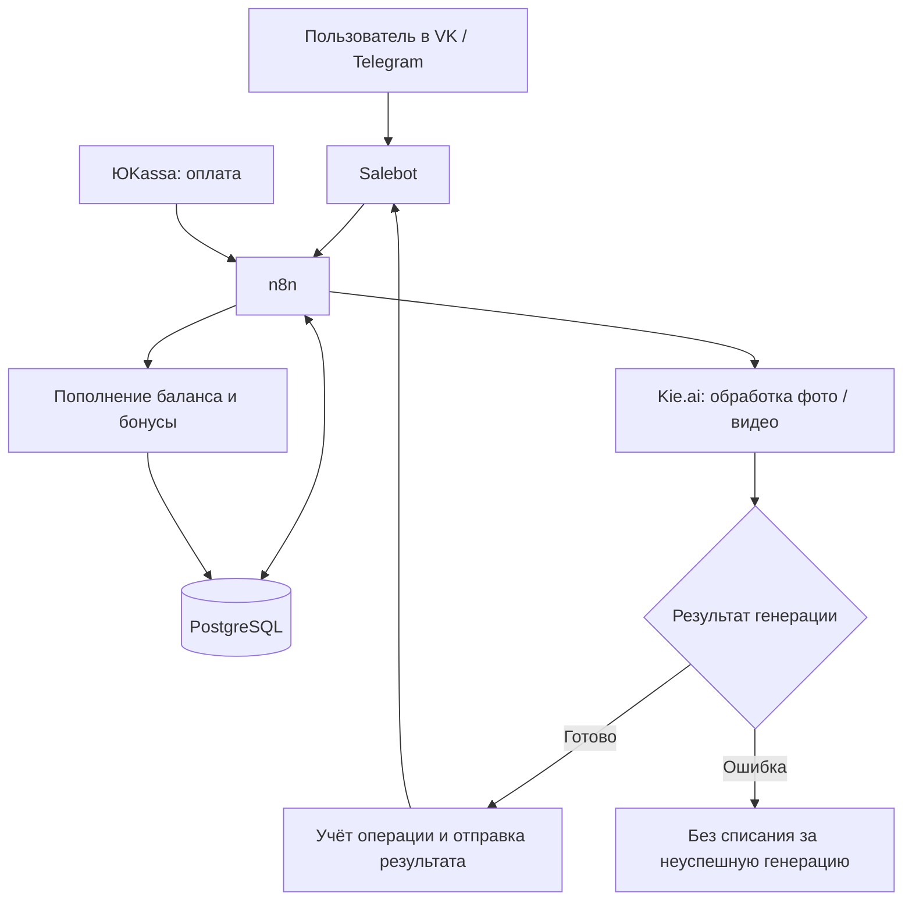

# «Живые фото» — AI-сервис в мессенджерах

**Реставрация фотографий, генерация стилизованных изображений и анимация с оплатой и внутренним балансом пользователя.**

[← Все кейсы](../README.md)

## Задача

Сделать генеративные инструменты доступными через привычный интерфейс мессенджера: человек загружает фото, выбирает действие и получает результат. Составлять промпты и самостоятельно оплачивать зарубежные сервисы ему не требуется.

Для платного продукта нужны были учёт пользователей, файлов и балансов, интеграция оплаты и корректное поведение при ошибке генерации.

## Мой вклад

Спроектировал разделение интерфейса и серверной логики, связал ботов с n8n, PostgreSQL и Kie.ai. Настроил платежи через ЮKassa, учёт балансов, пакетные предложения и реферальные бонусы. Развитие шло от MVP к дополнительным стилям и каналам.

## Из чего состоит решение

| Компонент | Роль |
| --- | --- |
| VK / Telegram и Salebot | Приём фото, меню, тарифы и доставка результата |
| n8n | Координация обработки, платежных событий и бонусов |
| PostgreSQL | Данные пользователей, учёт файлов, статусов и балансов |
| Kie.ai | Доступ к моделям обработки изображений и генерации видео |
| ЮKassa | Оплата и пополнение внутреннего баланса |
| Реферальная логика | Начисление бонусов за приглашения |

## Как работает

Это функциональная схема: она не раскрывает внутренние запросы, структуру таблиц и платёжные обработчики.

## Ключевые решения

- **Общая логика для нескольких каналов.** Подключение Telegram после VK не требовало переписывать основную обработку.
- **Баланс и история в базе данных.** Пользовательские состояния учитываются отдельно от интерфейса бота.
- **Заранее подготовленные сценарии генерации.** Выбор кнопки определяет обработку и параметры запроса к модели.
- **Обработка неуспешной генерации.** В описанном сценарии ошибка внешней модели не приводит к списанию средств за результат, который пользователь не получил.

## Этапы

1. **Первые 14 дней:** базовые интеграции, реставрация и анимация — запуск MVP.
2. **Недели 3–4:** развитие платежей, тарифов, приветственного баланса и реферальной механики.
3. **Недели 5–6:** расширение вариантов стилизации.

Полный набор функций развивался после первой версии; срок 14 дней относится к MVP.

## Результат

**2 000 пользователей протестировали сервис в первые недели после запуска.** Это число пользователей, а не покупателей или оплат.

Получился продукт с пользовательским интерфейсом, генеративным ядром и собственным учётом операций.

**Стек:** Salebot, n8n, PostgreSQL, Kie.ai, ЮKassa, VK, Telegram.

**Статус в описанном периоде:** сервис запущен, функциональность расширялась итерациями.

---

Опубликован разбор реализации. Код, workflow, схема базы, платёжные настройки и пользовательские фотографии закрыты.

[Обсудить похожую задачу](https://t.me/BorisKS) · [Все кейсы](../README.md)
