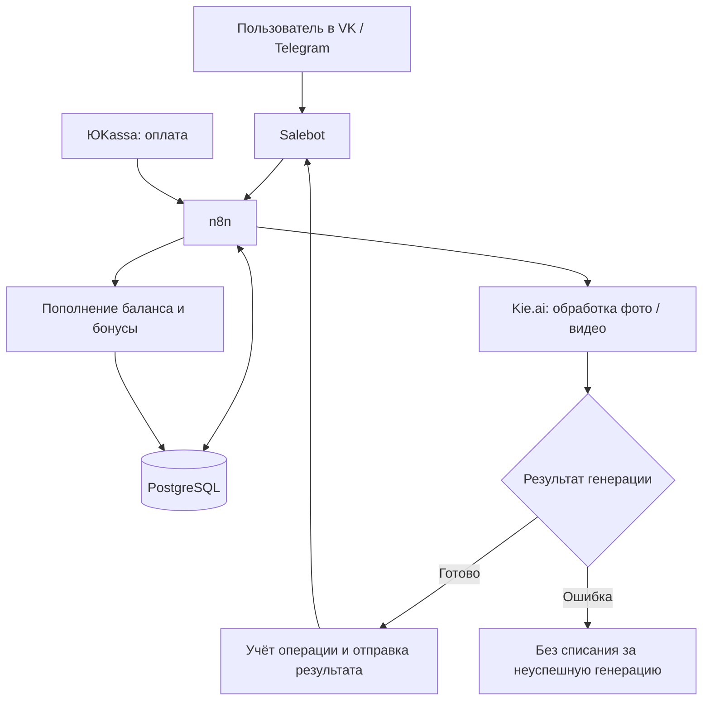

# «Живые фото»: 2 000 пользователей AI-сервиса на старте

**Превратил сложные генеративные сервисы в понятный продукт внутри VK и Telegram: загрузить фото, выбрать действие и получить результат. MVP запущен за 14 дней; в первые недели сервис протестировали 2 000 пользователей.**

[← Все кейсы](../README.md)

## Задача бизнеса

Человек хочет оживить семейную фотографию или сделать стилизованный портрет, но не хочет разбираться в промптах, настройках нейросетей и оплате зарубежных сервисов. Продукту нужно было убрать этот технический барьер.

Со стороны бизнеса требовался полный путь покупки: выбор услуги, пополнение баланса, генерация и выдача результата. Файлы, платежи и ошибки нужно было учитывать в общей системе.

## Как изменилась работа

| Рабочая задача | После внедрения |
| --- | --- |
| Пользователю нужно освоить генеративные инструменты | Он выбирает действие кнопкой в привычном мессенджере |
| Для разных эффектов нужно готовить запросы | Нужные инструкции подставляются под выбранную услугу |
| Каждую операцию нужно связать с оплатой и пользователем | Система хранит файлы, статусы и баланс, обрабатывает ошибки |

## Мой вклад

Спроектировал разделение интерфейса и серверной логики, связал ботов с n8n, PostgreSQL и Kie.ai. Настроил биллинг — учёт оплат и внутреннего баланса: платежи через ЮKassa, пакетные предложения и реферальные бонусы. Развитие шло от MVP к дополнительным стилям и каналам.

## Из чего состоит решение

| Компонент | Роль |
| --- | --- |
| VK / Telegram и Salebot | Приём фото, меню, тарифы и доставка результата |
| n8n | Оркестрация: координация обработки, платёжных событий и бонусов |
| PostgreSQL | Данные пользователей, учёт файлов, статусов и балансов |
| Kie.ai | Доступ к моделям обработки изображений и генерации видео |
| ЮKassa | Оплата и пополнение внутреннего баланса |
| Реферальная логика | Начисление бонусов за приглашения |

## Как работает

Это функциональная схема: она не раскрывает внутренние запросы, структуру таблиц и платёжные обработчики.

## Ключевые решения

- **Общая логика для нескольких каналов.** Подключение Telegram после VK не требовало переписывать основную обработку.
- **Баланс и история в базе данных.** Пользовательские состояния учитываются отдельно от интерфейса бота.
- **Заранее подготовленные сценарии генерации.** Выбор кнопки определяет обработку и параметры запроса к модели.
- **Обработка неуспешной генерации.** В описанном сценарии ошибка внешней модели не приводит к списанию средств за результат, который пользователь не получил.

## Этапы

1. **Первые 14 дней:** базовые интеграции, реставрация и анимация — запуск MVP.
2. **Недели 3–4:** развитие платежей, тарифов, приветственного баланса и реферальной механики.
3. **Недели 5–6:** расширение вариантов стилизации.

Полный набор функций развивался после первой версии; срок 14 дней относится к MVP.

## Результат

**2 000 пользователей протестировали сервис в первые недели после запуска.** Это число пользователей, а не покупателей или оплат.

Получился продукт с пользовательским интерфейсом, генеративным ядром и собственным учётом операций.

**Стек:** Salebot, n8n, PostgreSQL, Kie.ai, ЮKassa, VK, Telegram.

**Статус в описанном периоде:** сервис запущен, функциональность расширялась итерациями.

---

Опубликован разбор реализации. Код, workflow, схема базы, платёжные настройки и пользовательские фотографии закрыты.

[Обсудить запуск AI-сервиса](https://t.me/BorisKS) · [Все кейсы](../README.md)
