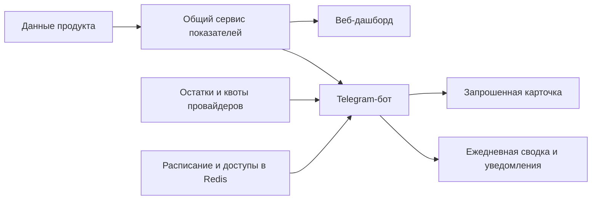

# Telegram-аналитика для владельца «Твоего хита»

**Вывел ключевые показатели продукта в Telegram: сводки, этапы воронки, оплаты, генерации и уведомления о состоянии внешних сервисов.**

[← Все кейсы](../README.md)

## Задача

Дать владельцу и команде быстрый доступ к состоянию продукта без постоянного открытия полной веб-панели. В одном месте нужны итоги дня, возможность проверить выбранный период и предупреждения об остатках сервисов.

Важно было сохранить одинаковые определения показателей в Telegram и внутреннем дашборде.

## Мой вклад

Разработал Telegram-интерфейс к существующей системе аналитики. Настроил меню, карточки, фильтры, ежедневные сводки и управление доступом. Подключил отображение остатков провайдеров и служебные напоминания.

Для расчётов использовал общий серверный сервис показателей, на котором работает веб-дашборд.

## Что показывает бот

- Регистрации и распределение по MAX и браузеру.
- Этапы работы с демо и переходы к оплате.
- Уникальных покупателей, количество оплат и выручку.
- Готовые генерации, ошибки и текущее состояние очереди.
- Текущие остатки AI-провайдеров и расходы на AI за выбранный период.
- Остаток квоты Unisender Go и дату окончания периода.
- Служебные напоминания о ресурсах и сроках продления.

Пользователь может выбрать сегодня, вчера или неделю, переключить платформу, обновить карточку либо перейти к защищённому веб-дашборду.

## Из чего состоит решение

| Компонент | Назначение |
| --- | --- |
| Telegram Bot API | Команды, inline-кнопки и обновление сообщений |
| TypeScript / NestJS | Логика бота и подключение общих метрик |
| AdminMetricsService | Те же определения и серверные срезы, что в веб-панели |
| PostgreSQL | Исходные бизнес-данные продукта через существующий сервис отчётов |
| Redis | Настройки, доступы, расписания и состояние обработки обновлений |
| API внешних сервисов | Остатки, лимиты и другие доступные эксплуатационные показатели |

## Как работает

## Ключевые решения

**Общая основа расчётов.** Telegram использует действующий сервис метрик. Значения можно сопоставлять с веб-панелью с учётом выбранных дат и платформ.

**Быстрое взаимодействие.** Кнопки меняют период и раздел, обновляя текущую карточку. Подробности остаются в полной панели.

**Настраиваемые ежедневные итоги.** Пользователь выбирает время получения сводки и может отключить её. Час доставки отделён от календарных границ расчёта данных.

**Доступ с одобрением владельца.** Новый пользователь отправляет заявку. Владелец разрешает просмотр или отзывает доступ; роль зрителя не даёт управления другими пользователями.

**Остатки отдельно от расходов.** Баланс сервиса показывает текущее состояние аккаунта, а расходы относятся к выбранному периоду. Недоступное значение отображается как недоступное и не превращается в ноль.

**Предупреждение о квоте писем.** При остатке Unisender Go ниже 20% включается напоминание с ограничением частоты. После восстановления лимита предупреждения прекращаются.

## Проверка

Проверялись форматирование карточек, фильтры, совпадение расчётов с веб-панелью, права доступа, расписания и поведение после перезапуска. Доставка сводок и работа с актуальными остатками проверены в подключённом Telegram-боте.

При неопределённом результате сетевой отправки сводка не повторяется автоматически: это снижает риск дубля, но допускает пропуск отдельного выпуска. Ручной просмотр показателей остаётся доступным.

## Результат

Ключевые цифры проекта доступны в Telegram по запросу и в ежедневной сводке. Владелец может быстро проверить продажи, генерации и остатки сервисов, а за подробным разбором перейти в веб-панель.

Бот дополняет внутренний веб-дашборд: подробный разбор воронки остаётся в панели, а ключевые показатели и уведомления доступны в Telegram.

**Статус:** подключён к рабочему проекту, сводки и уведомления используются в Telegram.

**Стек:** TypeScript, NestJS, Telegram Bot API, PostgreSQL, Redis, API внешних сервисов, Docker.

---

Описание закрытого внедрения. Код, реальные показатели, рабочие идентификаторы и ключи не публикуются.

[Обсудить похожую задачу](https://t.me/BorisKS) · [Все кейсы](../README.md)
