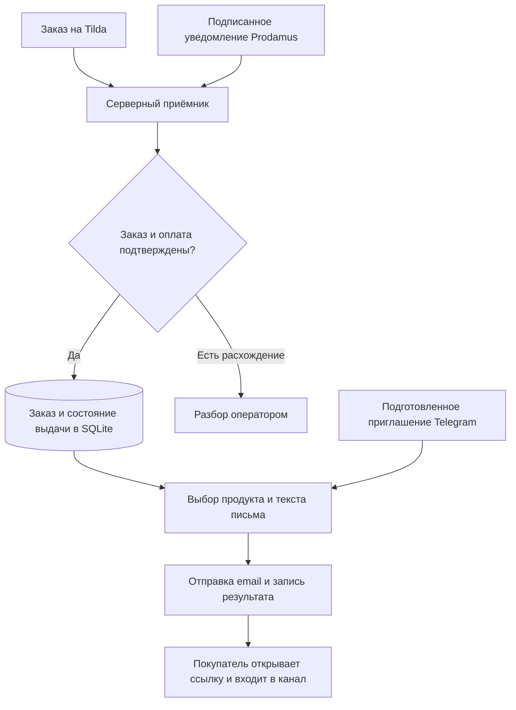

# Автоматическая выдача продуктов после оплаты на Tilda

**Связал Tilda, Prodamus, email и Telegram: подтверждённая покупка запускает письмо с доступом к материалам.**

[← Все кейсы](../README.md)

## Задача

Автоматизировать путь от покупки цифрового продукта на сайте до получения доступа к материалам в Telegram. Система должна сопоставить заказ и платёж, выбрать нужные правила выдачи и отправить покупателю понятное письмо.

Для операционной работы требовались история отправок, управляемые тексты и восстановление проблемных случаев.

## Мой вклад

Разработал серверную интеграцию Tilda и Prodamus, хранение заказов и отдельный процесс выдачи. Подключил отправку писем, работу с Telegram-приглашениями, каталог продуктов и операторские инструменты.

Последовательно развивал пользовательский путь: от письма с кодом для бота к прямой ссылке входа в канал после подтверждённой оплаты.

## Из чего состоит решение

| Компонент | Назначение |
| --- | --- |
| Tilda | Витрина, тарифы и исходный заказ |
| Prodamus | Оплата и подписанный webhook — автоматическое уведомление сервера о её результате |
| Серверный приёмник на Node.js | Сопоставление заказа, состава, суммы и подтверждения оплаты |
| SQLite | Состояния заказов, правила выдачи и история обработки |
| Отдельный процесс выдачи | Подготовка письма, отправка и учёт результата |
| SMTP / Nodemailer | Письмо покупателю с инструкцией и ссылкой |
| Telegram Bot API | Подготовка приглашения в нужный канал |
| Каталог и операторские инструменты | Настройка продуктов, писем и работа с проблемными отправками |
| Docker / Caddy | Развёртывание и HTTPS для серверных обработчиков |

## Как работает

## Ключевые решения

**Выдача по подтверждённой покупке.** Уведомление проверяется по подписи и данным заказа. Несовпадения суммы, состава или статуса требуют отдельного разбора.

**Разделение приёма событий и выдачи.** Получение заказа и отправка письма имеют собственные состояния. Это позволяет наблюдать, на каком шаге возникла проблема.

**Идемпотентность (idempotency).** Повтор одного и того же платёжного события проверяется по сохранённому состоянию. Уже успешно отправленное письмо не создаётся заново: повтор запроса не должен становиться повторной выдачей.

**Простой путь покупателя.** В текущем сценарии человек получает письмо с кнопкой входа в канал. Подготовку приглашения выполняет технический бот; покупателю не нужно вводить код.

**Обработка ошибок и операторское восстановление.** Если результат отправки неизвестен, оператор проверяет историю и архив писем перед повтором. Такой разбор снижает риск отправить доступ дважды.

## Проверка

Реальной покупкой проверены подтверждение оплаты, получение письма и вступление нового участника в канал. Повторы, перезапуск, расхождения заказа и платёжные проверки отрабатывались на тестовых событиях.

Обработчик поддерживает **RUB, USD, EUR, KZT и BYN**. Поддержка всех пяти валют проверена тестовыми событиями; реальные покупки во всех валютах не заявляются.

Прямая ссылка в письме может быть переслана другому человеку. Этот вариант выбран ради короткого пути к материалам и не связывает приглашение с единственным покупателем.

## Результат

Работает автоматическая цепочка от подтверждённой оплаты до письма с доступом. Для штатной покупки оператору не требуется вручную сопоставлять платёж, искать приглашение и отправлять его клиенту.

Тексты и правила выдачи вынесены в управляемую конфигурацию, а состояние заказов и писем доступно для контроля и восстановления.

**Статус:** внедрено, основной путь проверен реальной покупкой.

**Стек:** Tilda, Prodamus, Node.js, SQLite, SMTP, Nodemailer, Telegram Bot API, Docker, Caddy.

---

Описание закрытого внедрения. Код, платёжные настройки, рабочая база, письма покупателей и приглашения не публикуются.

[Обсудить похожую задачу](https://t.me/BorisKS) · [Все кейсы](../README.md)
