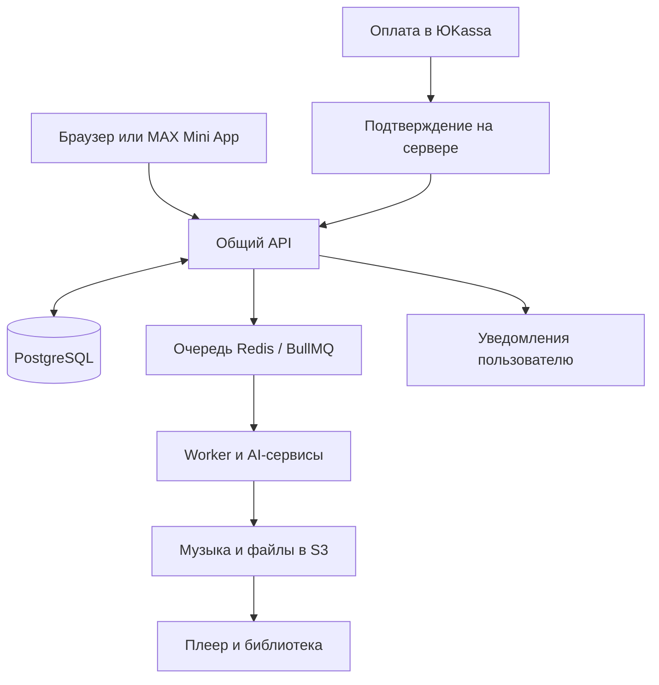

# «Твой хит» — музыкальный AI-продукт в браузере и MAX

**Разработал сервис персональных песен: от идеи и бесплатного демо до покупки, генерации полной версии и сохранения результата в библиотеке.**

[← Все кейсы](../README.md)

## Задача

Сделать создание песни доступным человеку, который не умеет писать промпты и пользоваться музыкальными нейросетями. Пользователь должен описать идею или добавить свой текст, выбрать звучание, получить песню и оплатить дальнейшие возможности в привычном интерфейсе.

Для бизнеса требовался полноценный продукт с авторизацией, платежами, внутренним балансом, историей генераций и инструментами управления.

## Мой вклад

Спроектировал и разработал веб-приложение и MAX Mini App с общим сервером и данными. Реализовал пользовательские сценарии создания песен, работу с текстом, плеер, библиотеку, кошелёк и оплату. Подключил внешние AI-сервисы, уведомления и административную панель.

Разработку и доработки вёл с помощью Codex. Пользовательский путь и формулировки оферов уточнялись совместно с командой проекта.

## Что умеет сервис

- Создавать бесплатное музыкальное демо по ответам пользователя.
- Генерировать полный текст и песню по идее или собственному тексту.
- Редактировать текст, выбирать жанр и вокал.
- Создавать профиль собственного голоса для соответствующих сценариев генерации.
- Принимать оплату за пакеты и учитывать внутренний баланс.
- Хранить готовые песни, воспроизводить и выдавать доступные MP3.
- Показывать состояние генерации и возвращать пользователя к результату.

## Из чего состоит решение

| Компонент | Назначение |
| --- | --- |
| React / Vite | Общий клиент для браузера и MAX с платформенными адаптерами |
| NestJS / Fastify | API, пользовательские сценарии и бизнес-правила |
| PostgreSQL / Prisma | Пользователи, проекты песен, генерации и финансовые записи |
| Redis / BullMQ и worker | Очереди и фоновая обработка длительных операций |
| Приватное S3-хранилище | Файлы и результаты генераций |
| Kie.ai / Suno и языковые модели | Подготовка текста и музыкального результата |
| ЮKassa | Оплата и подтверждение платёжных событий |
| MAX, SaleBot, почтовые сервисы | Связь с пользователем и уведомления |
| Docker Compose, Caddy, Nginx | Развёртывание, HTTPS и доставка приложения |

## Как работает

## Ключевые решения

**Общий продукт для двух платформ.** Серверные правила и данные пользователя едины. Отличия входа, навигации и системных возможностей вынесены в адаптеры браузера и MAX.

**Фоновая генерация.** Создание музыки не привязано к одному открытому экрану: сервер хранит состояние задания, а результат появляется в пользовательской библиотеке.

**Серверный учёт платежей.** Доступ к платным возможностям связан с подтверждённой оплатой и состоянием кошелька.

**Быстрый путь к первому результату.** В браузере реализован гостевой сценарий создания демо без предварительного ввода почты и кода подтверждения. Дальнейший вход и восстановление доступа обрабатываются отдельно.

## Проверка

При разработке проверялись пользовательские и административные сценарии, авторизация, состояния генераций, платёжные уведомления и работа общих компонентов в браузере и MAX. В проекте используются API- и интерфейсные тесты, проверка типов и production-сборки.

## Результат

Запущен музыкальный AI-сервис с двумя пользовательскими каналами, собственной бизнес-логикой, оплатой и библиотекой результатов. Основной путь от идеи до готовой песни собран в одном продукте.

Для управления продуктом разработаны внутренний веб-дашборд и [Telegram-аналитика](telegram-analytics.md). Панель используется для разбора воронки, а бот — для оперативных сводок и уведомлений.

**Статус:** продукт запущен и развивается итерациями.

**Стек:** TypeScript, React, Vite, NestJS, Fastify, PostgreSQL, Prisma, Redis, BullMQ, S3, Kie.ai, Suno, ЮKassa, MAX, SaleBot, Docker.

---

Описание закрытого проекта. Исходный код, настройки интеграций и пользовательские данные не публикуются.

[Обсудить похожую задачу](https://t.me/BorisKS) · [Все кейсы](../README.md)
